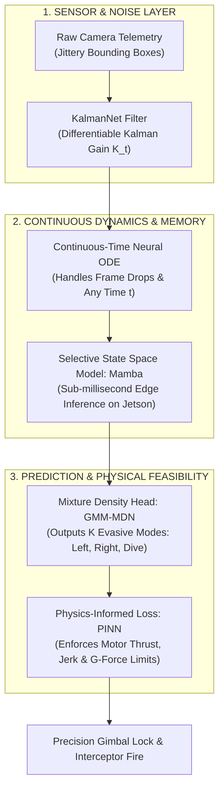
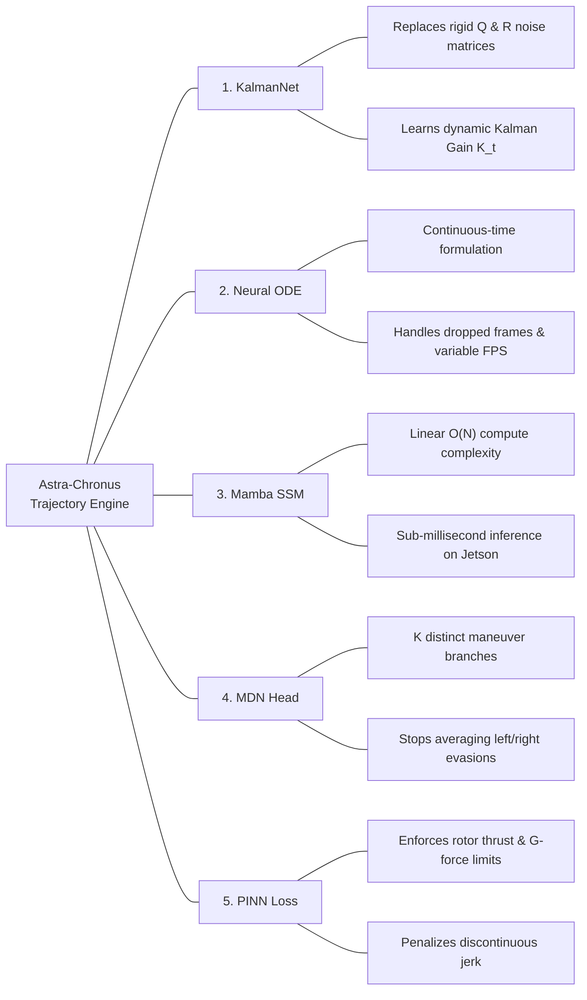
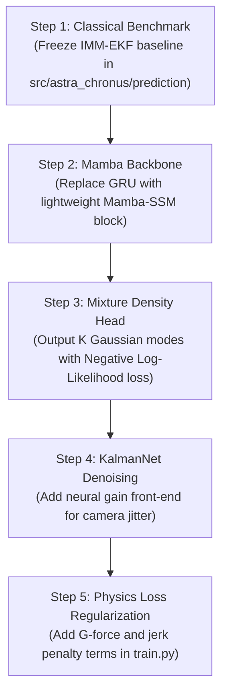

# Proposal: Beyond GRU & LSTM — The Next-Gen C-UAS Trajectory Engine

**Prepared for:** Team Astra Leadership & Research Club  
**Core Goal:** Transforming ASTRA-CHRONUS into an elite, publishable Counter-UAS research project (Target: IEEE / CVPR Anti-UAV Workshop / iDEX / DRDO)

---

## 1. The Hard Truth: Why We Must Move Past GRU & LSTM

Hey team,

If we submit a research paper in 2026 stating:  
> *"We trained an LSTM or GRU to predict drone flight paths."*

**It will be rejected almost immediately.** Why?
1. **Lacks Novelty:** LSTMs and GRUs are 10–15 year-old technologies. Reviewers consider them baseline benchmarks, not contributions.
2. **The "Snowball" Error Drift:** In our V0 tests, autoregressively rolling out a GRU was **14.6× worse than drawing a basic straight line** because tiny errors compounded exponentially.
3. **No Aerodynamic Common Sense:** GRUs happily predict impossible $15g$ turns or instant velocity reversals that physical drones cannot execute.
4. **The "Averaging Trap":** When an evasive drone can jink either **LEFT (50%)** or **RIGHT (50%)**, standard regression averages them together and predicts the drone flies **straight down the middle**—the one path it never takes!

To write a high-impact paper and win defense challenges, we need a smarter approach.

---

## 2. The Vision: The 5-Pillar Unified Architecture

Instead of picking just one shiny buzzword, we integrate **5 complementary superpowers**. They do not fight each other; each handles a specific layer of the tracking pipeline:

---

## 3. The 5 Pillars Explained Simply

### 1. Differentiable Kalman Filtering (KalmanNet) — *Input Denoising*
* **The Problem:** Video bounding boxes jitter constantly. Pure neural nets overfit to this noise.
* **Our Solution:** We keep the classical kinematic equations of motion, but use a compact neural network to dynamically calculate the **Kalman Gain ($K_t$)**.
* **The Payoff:** It smooths out video jitter during straight flight, but instantly opens up to catch aggressive maneuvers without delay.

### 2. Continuous-Time Neural ODEs — *Frame-Drop Resilience*
* **The Problem:** In the real world, cameras drop frames, weather occludes targets, and sensor rates fluctuate. Discrete networks break when time gaps ($\Delta t$) change.
* **Our Solution:** We model the drone’s latent flight path as a continuous vector field: $\frac{d\mathbf{h}(t)}{dt} = f_\theta(\mathbf{h}(t), t)$.
* **The Payoff:** The system can query the drone's position at *any exact millisecond* (e.g., $t + 0.385\text{ s}$), perfectly matching interceptor missile flight times.

### 3. Selective State Space Models (Mamba) — *Edge Efficiency*
* **The Problem:** Transformers are too slow ($O(N^2)$ quadratic compute) to run alongside YOLO on an embedded Nvidia Jetson.
* **Our Solution:** Mamba delivers Transformer-grade temporal attention with **linear $O(N)$ efficiency** and constant $O(1)$ memory rollout.
* **The Payoff:** Execution in **$< 1\text{ ms}$ on edge hardware**, leaving plenty of GPU headroom for video detection.

### 4. Multimodal Mixture Density Head (MDN) — *Solving Evasive Ambiguity*
* **The Problem:** When an evasive drone approaches an obstacle, it might break left or right. Standard MSE loss averages them into a useless center line.
* **Our Solution:** The network outputs parameters for $K$ distinct probability modes ($\pi_k, \mu_k, \Sigma_k$).
* **The Payoff:** The turret sees the full threat fan: *"60% chance hard left, 40% chance hard right,"* complete with 3D uncertainty ellipsoids.

### 5. Physics-Informed Kinematic Loss (PINN) — *No AI Hallucinations*
* **The Problem:** Black-box neural nets often predict physically impossible motion (e.g., $12g$ turns or infinite acceleration).
* **Our Solution:** We penalize physical violations directly in the loss function during training:
  $$\mathcal{L} = \mathcal{L}_{\text{data}} + \lambda_1 \mathcal{L}_{\text{G-limit}} + \lambda_2 \mathcal{L}_{\text{jerk}} + \lambda_3 \mathcal{L}_{\text{turn}}$$
* **The Payoff:** 100% aerodynamically feasible trajectories. No impossible turns, no phantom predictions.

---

## 4. Architectural Mindmap

---

## 5. Implementation Roadmap (Modular & Low-Risk)

We do not build everything at once. We follow an iterative 5-step delivery pipeline where each step yields a working benchmark:

1. **Step 1 (Week 1–2):** Baseline lockdown. Run constant velocity and IMM-EKF across clean benchmark splits.
2. **Step 2 (Week 3–4):** Mamba rollout. Verify sub-millisecond execution on GPU/Jetson.
3. **Step 3 (Week 5–6):** Multimodal head. Eliminate mode collapse on evasive maneuvers.
4. **Step 4 (Week 7–8):** KalmanNet front-end. Demonstrate stability against noisy bounding box inputs.
5. **Step 5 (Week 9–10):** Physics loss tuning. Verify zero aerodynamic boundary violations.

---

## 6. Why Leadership & Evaluators Will Back This

| Traditional Student Proposal | Our Proposed PIN-Mamba Architecture |
| :--- | :--- |
| *"We used PyTorch to train an LSTM."* | *"We unified continuous State-Space Models with Differentiable Kalman Filtering."* |
| Fails on dropped camera frames and variable FPS. | Continuous-time formulation natively absorbs frame drops and time jitter. |
| Collapses to the middle during evasive left/right breaks. | Multimodal density head captures distinct evasive branches. |
| Hallucinates physically impossible turns. | Physics-informed loss guarantees aerodynamic feasibility. |
| Too slow or heavy for edge hardware. | Linear $O(N)$ Mamba runs in $< 1\text{ ms}$ on an embedded Nvidia Jetson. |

### The Academic Paper Pitch
> **"PIN-Mamba: A Physics-Informed Continuous State-Space Framework with Differentiable Kalman Filtering for Multimodal Evasive UAV Trajectory Forecasting on Edge Hardware"**

This proposal directly addresses the real-world constraints of counter-UAS defense while establishing strong academic novelty. Let's build it!
